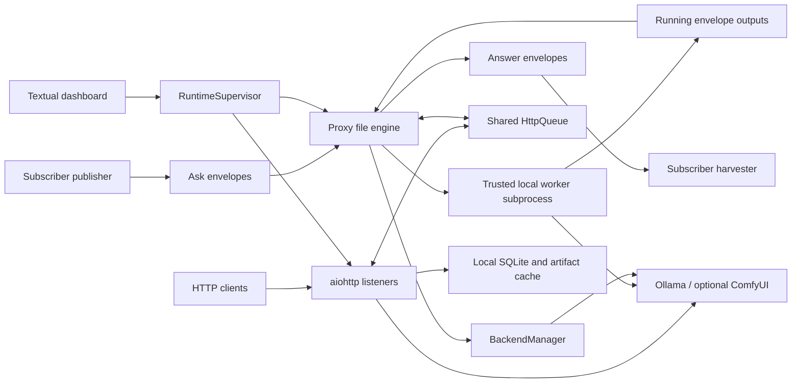

# System architecture

AI_Proxy combines eventually synchronized filesystem jobs and local HTTP
requests into serialized expensive work. A **subscriber** is an application
namespace with locally registered one-job workers. A **backend** is an execution
family (`ollama` or `comfyui`); a **resource key** identifies a model/workflow for
affinity. An **execution slot** is the scheduler's right to dispatch expensive
work, not a GPU driver lock. See [scheduling](COMPONENTS/SCHEDULING.md) for ordering.

## Boundaries and communication

| Boundary | Owner and communication |
| --- | --- |
| App business logic | Subscribers publish immutable envelopes and harvest durably/idempotently. No subscriber application imports in this repository; examples/registries are integration references. |
| File transport | [engine.py](../file_proxy/engine.py) owns transitions and worker execution; [validation.py](../file_proxy/validation.py) checks manifests, inventory, and relative references; [registry.py](../file_proxy/registry.py) resolves trusted commands. |
| Shared dispatch | `Proxy.run_scheduler` and [scheduler.py](../file_proxy/scheduler.py) coordinate file work and HTTP futures. Blocking file operations run via `asyncio.to_thread`; active workers are shielded from scheduler cancellation. |
| HTTP API | [http_proxy.py](../file_proxy/http_proxy.py) owns listeners, admission, forwarding, prompt settlement, restart reconciliation, and archive publication. Requests go to configured upstreams with `allow_redirects=False`. |
| Backend lifecycle | [backend.py](../file_proxy/backend.py) owns managed ComfyUI processes and residency transitions, not subscriber task semantics or the Ollama server process. |
| Local metadata | [store.py](../file_proxy/store.py) owns HTTP lifecycle SQLite/cache; file engine owns local worker outcome journals; [diagnostics.py](../file_proxy/diagnostics.py) owns short-lived HTTP diagnostics. |
| UI lifecycle | [supervisor.py](../file_proxy/supervisor.py) owns restartable runtime/tasks/log snapshots; [tui.py](../file_proxy/tui.py) renders and invokes lifecycle actions. |
| Optional normalization | [reasoning_policy.py](../file_proxy/reasoning_policy.py) applies alias-specific effort mappings to one HTTP route. Task prompts remain client/subscriber-owned. |

## Initialization and execution modes

Entry: `file-proxy` in [pyproject.toml](../pyproject.toml) -> `cli.main` in
[cli.py](../file_proxy/cli.py). Global arguments select queue, registry, and
optional runtime config. CLI loads/resolves config, applies explicit overrides,
validates it, loads **all** registry files, and creates `Proxy`.

| Mode | Execution lifecycle |
| --- | --- |
| `once` | Ensure queue layout, acquire local lock, recover interrupted jobs, process at most one selected ask. Does not construct BackendManager, HTTP services, or HTTP store. |
| `run`, no listeners and managed mode off | `Proxy.run`: local lock, interrupted recovery, synchronous scan/execute/publish loop. |
| `run`, listeners or managed mode on | `run_http_proxies`: build shared queue/admission, local store/diagnostics/policy/manager; ensure layout if available; acquire lock; recover/reconcile; start listeners; run async scheduler. Managed file-only mode needs no HTTP listener. |
| `tui` | `ProxyDashboard` starts `RuntimeSupervisor`; supervisor selects async runtime when listeners/managed mode exist, otherwise a stoppable filesystem thread. Snapshot reports readiness separately from backend health. |

Runtime paths, configuration precedence, persisted entities, and default limits
are owned by [DATA_MODEL.md](DATA_MODEL.md), not by synchronized envelopes.

## Major flows and asynchronous work

File flow: subscriber publishes hidden staging by rename -> validate and defer
incomplete sync -> select -> backend preparation in async mode -> move to Running
-> one subprocess -> validate outputs -> journal outcome locally -> atomically
write result -> move to Answer -> subscriber harvest. Recovery never reruns an
interrupted worker. See [file transport](COMPONENTS/FILE_TRANSPORT.md).

HTTP flow: special/cache routes first -> bypass or admission/read body -> optional
effort normalization -> enqueue -> scheduler signals `started` -> upstream relay
-> handler/lifecycle signals `finished`. ComfyUI prompt lifecycle tasks outlive
the submission response and reconcile history before releasing the slot. Ollama
streams hold the slot through relay completion. See [HTTP transport](COMPONENTS/HTTP_TRANSPORT.md).

Other asynchronous work: ComfyUI readiness/history polling,
concurrent backend health probes, and dashboard refreshes. Managed process stdout
is captured in a background thread. SQLite opens per-operation connections under
an `RLock`; the runtime does not persist undispatched HTTP request bodies.

Shutdown closes admission/listeners, wakes pending clients, winds down prompt
tasks, closes owned backends, and evicts eligible cache records. The async file
worker finishes before scheduler cancellation propagates; the filesystem-only
dashboard thread stops between jobs. A crashed proxy can still leave ambiguous
external side effects: single-attempt execution is not exactly-once delivery.

## Constraints and evidence limits

- One designated proxy per queue is an operational requirement. The local lock
  is shared by processes using the same runtime directory, not by all machines
  observing a Dropbox queue. Separate runtime directories can bypass it.
- Managed mode is opt-in and loopback-only for ComfyUI. It never adopts/kills a
  manual ComfyUI instance. GPU sharing assumes clients use this scheduler; direct
  backend requests are outside its control.
- HTTP scheduling and artifact archiving are concentrated in `http_proxy.py`;
  `engine.py` also couples transport, ordering, subprocesses, and Forge cleanup.
  Cross-cutting refactors need an impact plan and contract-level tests.
- Retrospective choices are recorded in [DECISIONS](DECISIONS/0001-transport-and-local-state.md).
  Live Dropbox timing, real GPU applications, subscriber behavior, and Python
  3.10 compatibility were not verified; see development for known gaps.
